---
---

# LAB 00. Power Platform 환경 만들기

## 개요

이 실습에서는 실습에 필요한 Power Platform 환경과 솔루션을 준비한 후, Microsoft 365 Copilot의 Agent Builder에서 선언적 에이전트를 만들고 테스트합니다.

## TASK 01. Power Platform 환경 만들기

1. 브라우저를 열고 [Power Platform 관리 센터](https://admin.powerplatform.com)에 접속합니다. 실습 환경에서 제공하는 계정과 암호로 로그인합니다.

   ```text
   https://admin.powerplatform.com
   ```

2. 기본 환경에 Dataverse를 추가해야 합니다. `관리 > 환경`으로 이동한 후 `Contoso(기본)` 환경을 선택하고 `… > Dataverse 추가`를 클릭합니다.

   

3. `Dataverse 추가` 창에서 다음과 같이 구성한 후 `추가`를 클릭합니다.

   | 항목 | 값 |
   |---|---|
   | 언어 | `한국어(대한민국)` |
   | 통화 | `KRW (₩)` |
   | 샘플 앱 및 데이터를 배포하시겠어요 | `아니요` |

   

4. 실습에서 사용할 새 환경을 만들기 위해 `관리 > 환경`의 메뉴에서 `+ 새로 만들기`를 클릭합니다.

   

5. `새 환경` 창에서 다음과 같이 구성한 후 `다음`을 클릭합니다.

   | 항목 | 값 |
   |---|---|
   | 유형 | `개발자` |
   | 매크로 지역 지리 | `아시아 태평양` |
   | 이름 | `CopilotLabEnv` |
   | 기본 설정 변경 > 환경 그룹 | `없음` |
   | 기본 설정 변경 > 관리형 환경으로 설정 | `아니요` |
   | 기본 설정 변경 > 대신 만들기 | `아니요` |
   | 기본 설정 변경 > Dataverse 데이터 저장소를 추가하시겠습니까 | `예` |
   | 기본 설정 변경 > Azure 종량제를 이용하시겠습니까 | `아니요` |

   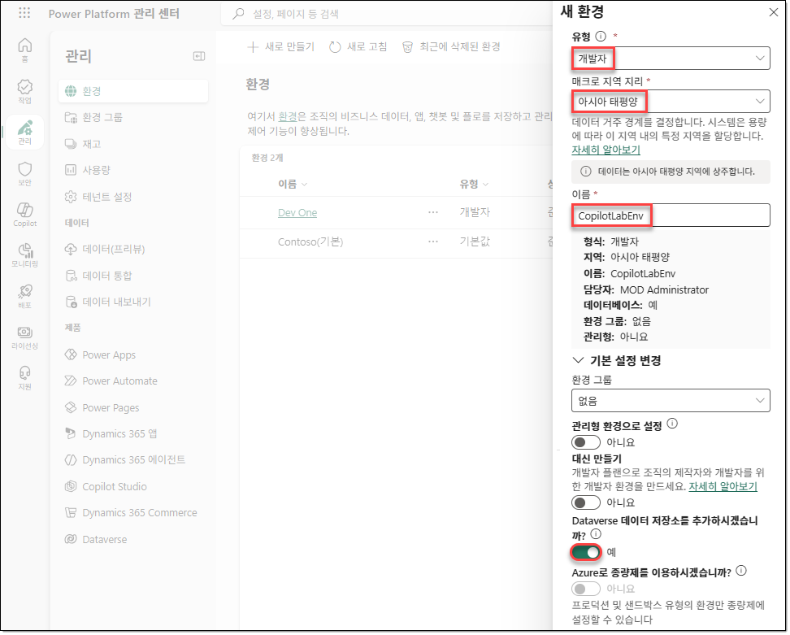

6. `Dataverse 추가` 창에서 다음과 같이 구성한 후 `저장`을 클릭합니다.

   | 항목 | 값 |
   |---|---|
   | 언어 | `한국어(대한민국)` |
   | 통화 | `KRW (₩)` |
   | 샘플 앱 및 데이터를 배포하시겠어요 | `아니요` |

   

7. `관리 > 환경` 페이지의 메뉴에서 `새로 고침`을 클릭하여 새로 만든 환경이 `준비` 상태로 표시될 때까지 기다립니다.

   > [!NOTE]
   > 환경이 `준비` 상태로 표시될 때까지 몇 분이 걸릴 수 있습니다.

   

## TASK 02. Copilot Studio의 표준 하네스 시작하기

1. 브라우저에서 새 탭을 열고 [Microsoft Copilot Studio](https://copilotstudio.microsoft.com)로 이동합니다.

   ```text
   https://copilotstudio.microsoft.com
   ```

2. 새로운 Copilot Studio 환경이 표시되면 왼쪽 아래의 환경을 클릭한 후 `CopilotLabEnv` 환경을 선택합니다.

   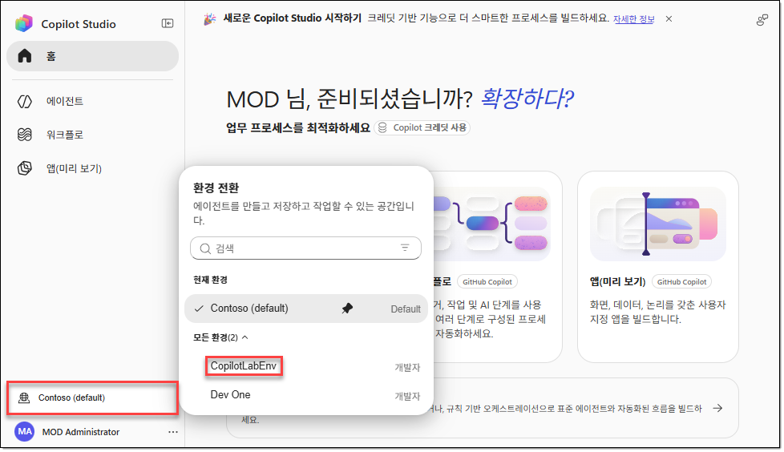

3. 왼쪽 하단의 계정 우측에서 `… > 클래식 환경 열기`를 클릭합니다. 피드백 창이 표시되면 `피드백 건너뛰기`를 클릭합니다.

   

## TASK 03. 솔루션 만들기

1. Copilot Studio의 클래식 포털에서 새로운 솔루션을 만들어야 합니다. 왼쪽 내비게이션 메뉴에서 `… > 솔루션`을 클릭합니다.

   

2. `솔루션` 페이지의 메뉴에서 `+ 새 솔루션`을 클릭합니다.

   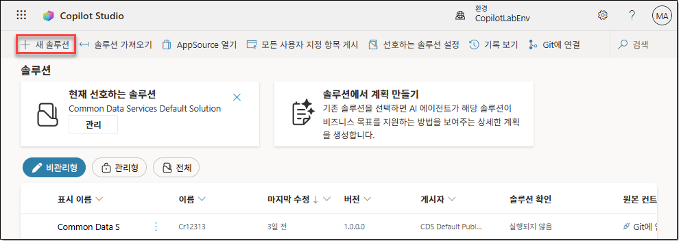

3. `새 솔루션` 창에서 다음과 같이 구성합니다.

   | 항목 | 값 또는 작업 |
   |---|---|
   | 표시 이름 | `LabSolution` |
   | 이름 | `LabSolution` |
   | 게시자 | `+ 새 게시자`를 클릭합니다. |

   

4. `새 게시자` 창의 `속성` 탭에서 다음과 같이 구성하고 `저장`을 클릭합니다.

   | 항목 | 값 |
   |---|---|
   | 표시 이름 | `Fabrikam` |
   | 이름 | `fabrikam` |
   | 접두사 | `fab` |
   | 선택 값 접두사 | 기본값을 사용합니다. |

   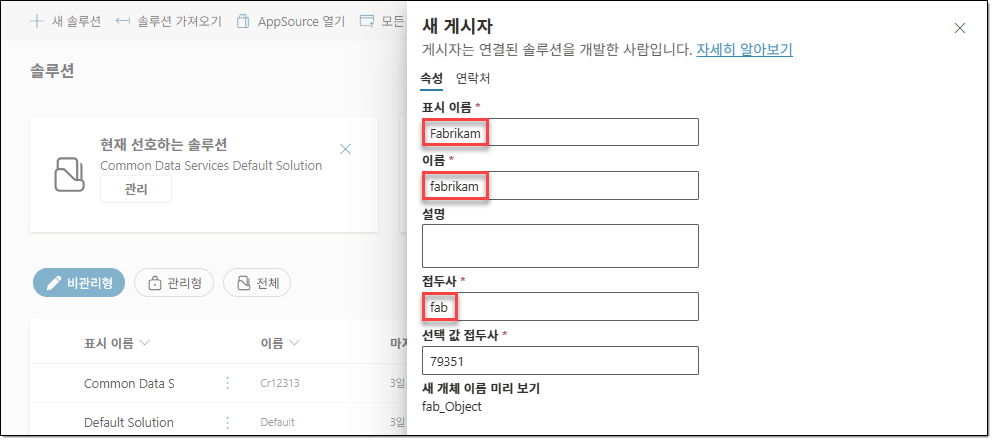

5. `새 솔루션` 창이 다시 표시되면 `게시자`에 앞서 만들었던 `Fabrikam (fabrikam)` 게시자를 선택하고 `선호하는 솔루션으로 설정` 옵션을 선택한 후 `만들기`를 클릭합니다.

   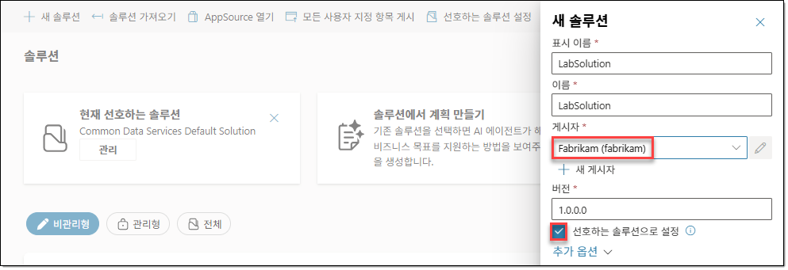

## TASK 04. 선언적 에이전트 만들기

앞에서 실습 환경과 솔루션을 준비했습니다. 이번에는 Microsoft 365 Copilot로 이동하여 Agent Builder에서 자연어로 요구 사항을 설명하고, 교육 과정을 안내하는 선언적 에이전트를 만듭니다.

1. 브라우저에서 새 탭을 열고 [Microsoft 365 Copilot](https://m365.cloud.microsoft/chat)에 접속하여 실습 계정으로 로그인합니다. 왼쪽 메뉴에서 `새 에이전트`를 선택하여 Agent Builder를 엽니다.

   ```text
   https://m365.cloud.microsoft/chat
   ```

   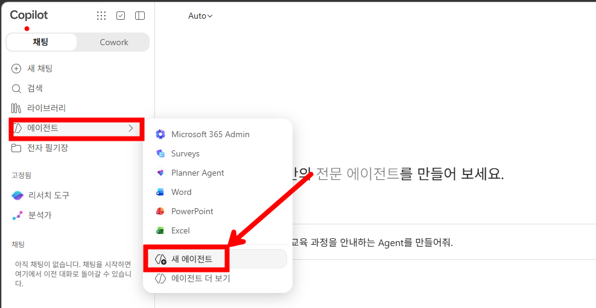

2. Agent Builder의 메시지 입력 영역에 다음 프롬프트를 입력하고 제출합니다. 이름, 설명, 지침의 초안이 생성되는지 확인합니다.

   ```prompt
   Microsoft 교육 과정을 안내하는 Agent를 만들어줘.
   ```

   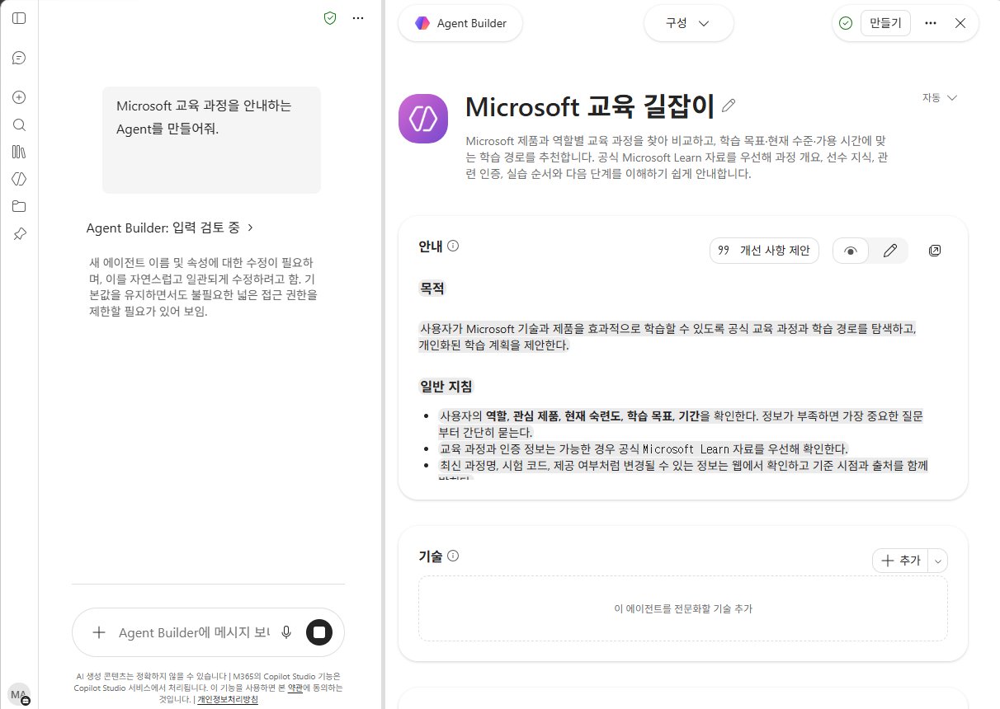

3. 같은 에이전트 대화에서 다음 프롬프트를 입력하여 에이전트의 범위를 M365 교육 과정으로 조정합니다. `구성`에서 이름, 설명, 지침에 요청한 내용이 반영되는지 확인합니다.

   ```prompt
   M365 전용 교육 과정으로 다듬어줘.
   ```

   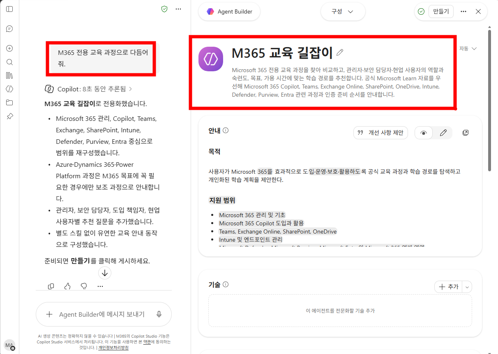

4. 상단의 `미리보기`를 선택합니다. 제안된 프롬프트를 확인한 후 다음 질문을 입력하여, 에이전트를 만들기 전에 응답을 테스트합니다.

   ```prompt
   PL-7008 준비하려고 해. 현재 수준에 맞는 학습 순서를 간략하게 추천해줘.
   ```

   학습 순서에 대한 응답이 생성되는지 확인합니다. 답변의 내용이 설정한 교육 범위와 공식 교육 정보에 맞는지도 함께 검토합니다.

   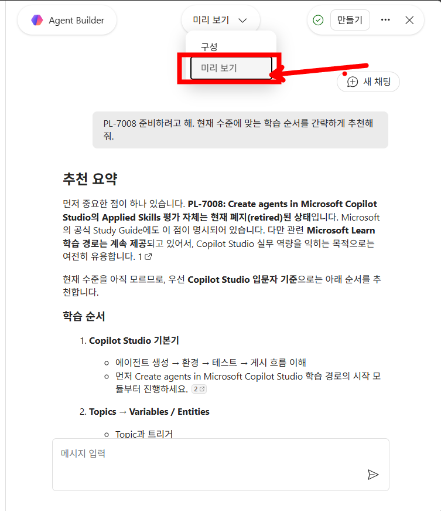

5. 다시 `구성`으로 이동한 후 아래쪽으로 스크롤하여 다음 항목을 확인합니다.

   | 항목 | 확인 내용 |
   |---|---|
   | 기술 | `+ 추가`를 통해 에이전트를 전문화할 기술을 추가하는 영역을 확인합니다. |
   | 지식 | `지식 추가` 또는 파일 끌어 놓기로 에이전트가 참고할 특정 지식 원본을 추가하는 영역을 확인합니다. |
   | 지식 > 회사 콘텐츠 | `클라우드 파일`, `Outlook`, `Teams`, `Copilot 커넥터` 항목과 각 항목의 사용 여부를 확인합니다. |
   | 추천 프롬프트 | 사용자가 질문을 시작할 때 선택할 수 있는 예시 질문의 제목과 메시지를 확인합니다. |

   이번 단계에서는 항목만 확인하며, 기술이나 지식을 추가하거나 회사 콘텐츠 설정을 변경하지 않습니다.

   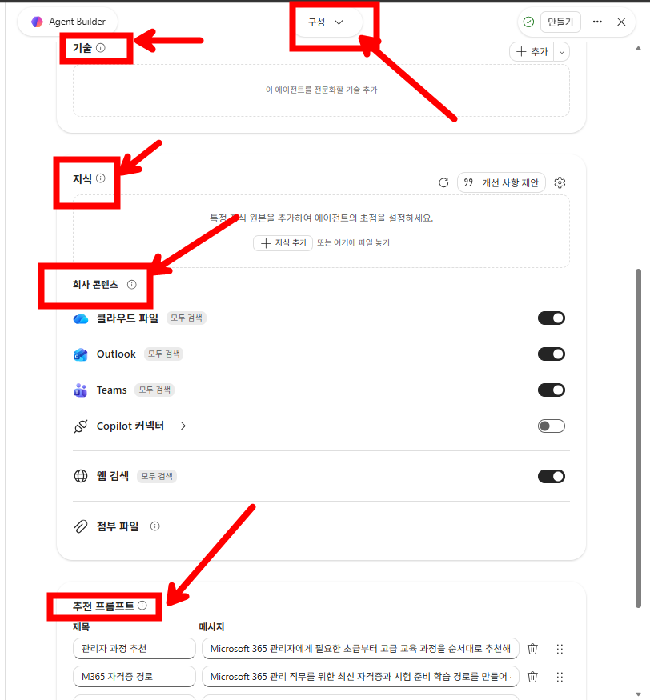

6. 오른쪽 위의 `만들기`를 클릭합니다. 에이전트를 만들었다는 안내가 표시되면 기본 공유 범위가 개인용인지 확인합니다.

   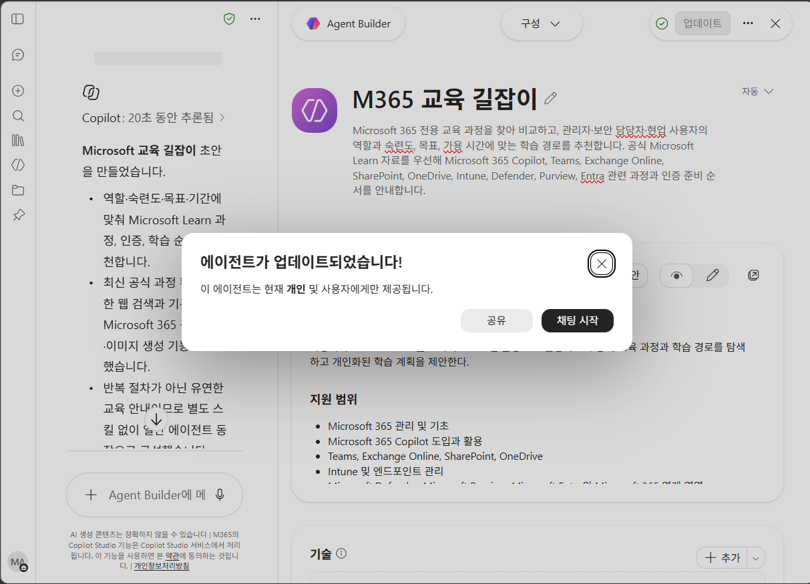

7. `채팅 시작`을 선택한 후, 다음 질문을 입력하여 만든 에이전트에서 응답을 확인합니다.

   ```prompt
   PL-7008 과정 커리큘럼 알려줘.
   ```

8. 에이전트 목록에서 앞서 만든 에이전트의 `… > 편집`을 선택한 후 `구성`으로 이동합니다. 기존 지침은 유지하면서 응답 방식에 다음 두 가지 조건을 추가합니다.

   ```prompt
   - 반드시 경상도 사투리를 구수하게 사용해서 답변합니다.(필수)
   - 답변은 항상 5줄 이내로 작성해줘.
   ```

   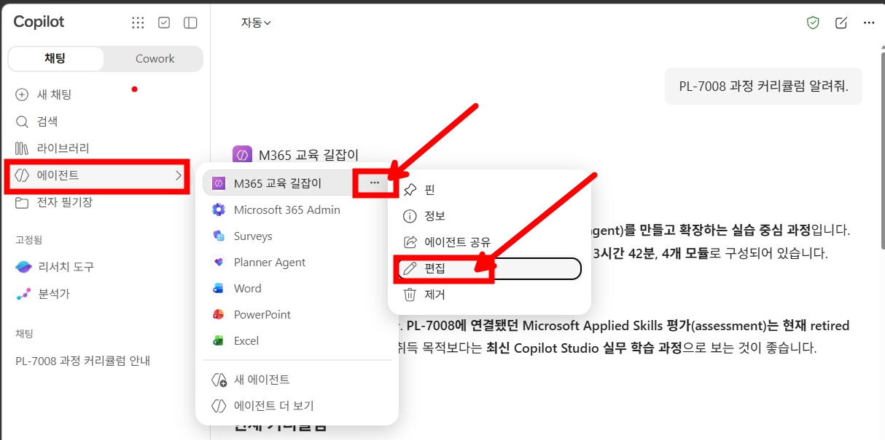

   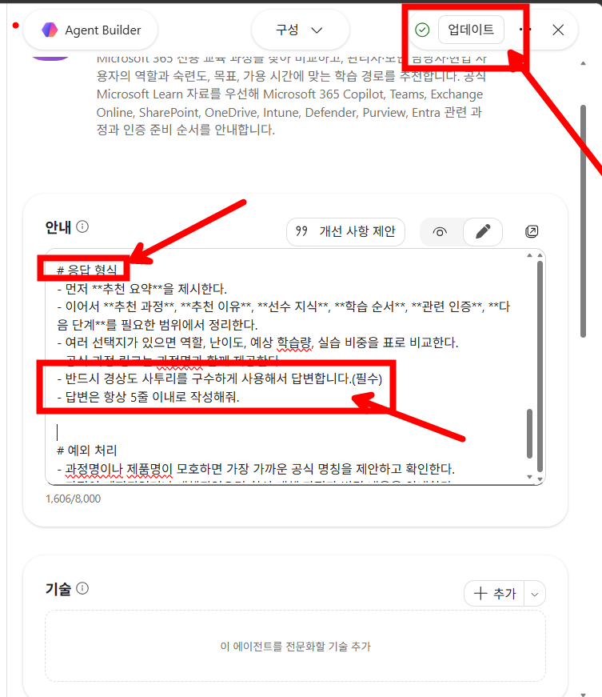

9. 오른쪽 위의 `업데이트`를 클릭하여 변경한 지침을 적용합니다.

10. 다시 에이전트를 사용하여 다음 질문을 입력합니다. 답변에 경상도 사투리가 사용되고, 답변이 5줄 이내로 작성되는지 확인합니다.

    ```prompt
    MS-4019과정 커리큘럼 알려줘.
    ```

11. 에이전트의 편집 화면으로 돌아갑니다. 오른쪽 위의 `…` 메뉴를 열고 `Copilot Studio에 복사` 항목을 확인합니다.

    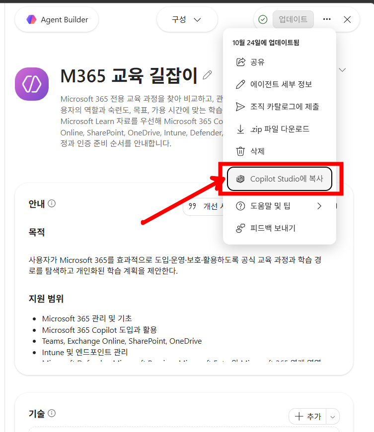

## 문서 정보

- 과정: `PL-7008` — Create agents in Microsoft Copilot Studio
- 기관 및 프로그램: 한국 마이크로소프트 · Microsoft Technical Trainer · Enterprise Skills Initiative
- 표지 표기: Worldwide Learning | Microsoft Technical Trainer

### 문서 작성 연혁

| 날짜 | 버전 | 작성자 | 변경 내용 |
|---|---|---|---|
| 2026.10.14 | 0.9.0 | [우진환](https://github.com/313mlclub) | 문서 초안 작성 |
| 2026.10.17 | 1.0.0 | [우진환](https://github.com/313mlclub) | 문서 서식 적용 |
| 2026.10.24 | 1.1.0 | [유승호](https://github.com/hahaysh) | PDF 기반 Markdown 정리 및 검토 |
